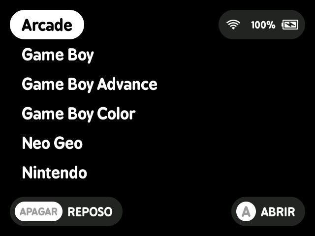
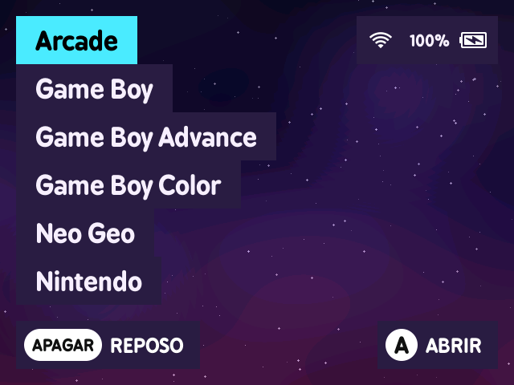
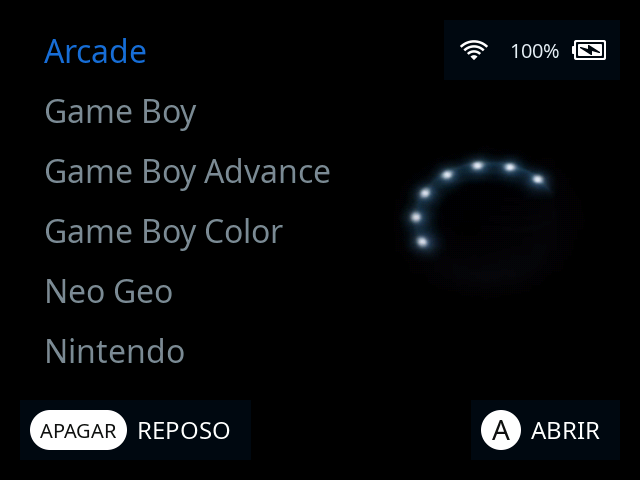
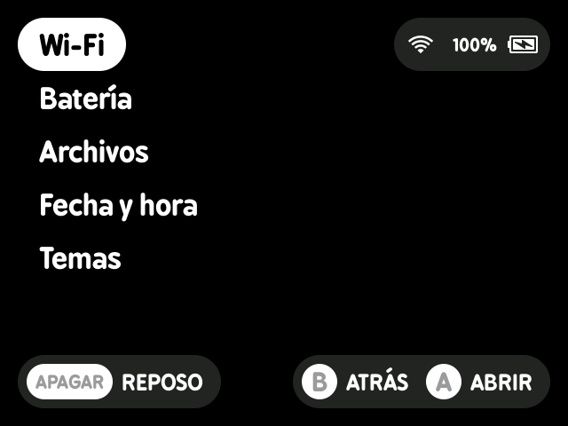

# MinUI en español para Miyoo Mini Plus

Versión personalizada de [MinUI](https://github.com/shauninman/MinUI), el launcher y frontend de libretro para
consolas retro portátiles, adaptada a una **Miyoo Mini Plus**: interfaz en **español**, **temas** con fondo, colores,
música y animaciones, **Wi-Fi** con sincronización de juegos y partidas con **RomM**, **logros de RetroAchievements**
sin conexión, juegos **arcade** y herramientas para el día a día.

> **Fork personal.** MinUI fue archivado por su autor en noviembre de 2025; este fork sigue desde esa versión y solo
> se prueba en la Miyoo Mini Plus.

| Clásico | Nebula | PS2 |
|---|---|---|
|  |  |  |

## Lo que agregué a MinUI

<table width="100%">
<tr>
<td valign="top" width="62%">

- **Interfaz en español**: menú principal, menú del juego, opciones y descripciones. Las configuraciones guardadas
  siguen en inglés por dentro, así los `.cfg` existentes funcionan igual.
- **Temas**: fondo, colores de la lista y de la barra, fuente y estilo de selección, elegibles en
  **Herramientas → Temas**. El tema **PS2** suma una animación de fondo, música en el menú y una animación al abrir
  un juego. Se pueden importar fondos de temas de Onion.
- **Batería en porcentaje** con el valor real, y la herramienta **Batería** con voltaje, estado de carga y un
  medidor de consumo por minuto.
- **Wi-Fi**: encender y apagar, ver la IP, explorador de archivos web en la consola y apagado automático tras 3
  minutos sin conexión.
- **Sincronización con RomM**: descarga los juegos de una colección de RomM y sincroniza partidas y estados en los
  dos sentidos, con el servicio `miyoo-sync` en un servidor de la casa.
- **Logros de RetroAchievements sin conexión**: se detectan mientras juegas, con aviso y sonido, y se envían a
  retroachievements.org al sincronizar.
- **Arcade**: paks de CPS1, CPS2, CPS3, Neo Geo, FBNeo y MAME, con pantalla de "Cargando…".
- **Orden personalizado** en los menús con el prefijo `N) ` (oculto al mostrar el nombre) y herramientas reducidas a
  las que se usan: Wi-Fi, Batería, Archivos, Fecha y hora y Temas.
- **Arreglo**: el efecto de pantalla *Línea* ya no cierra el emulador de PlayStation a 640×480.

</td>
<td valign="top" align="center" width="38%">
<br>
<sub>Herramientas, con el tema Clásico</sub>
</td>
</tr>
</table>

## Temas

| Tema | Cómo se ve |
|---|---|
| **Clásico** | El aspecto original de MinUI: fondo negro y selección en píldora blanca |
| **Nebula** | Fondo de nebulosa violeta con estrellas y selección en celeste |
| **PS2** | Inspirado en el menú de la PlayStation 2: animación de fondo, música ambiente, selección en azul y animación al abrir un juego |

Los temas van en la carpeta `Temas/` de la SD y se cambian desde **Herramientas → Temas**. Cómo crear uno, importar
un tema de Onion y generar las animaciones: [guía de temas](docs/Temas.md).

## Instalación

Igual que MinUI: se compila con Docker y se copia a la SD.

```bash
git clone https://github.com/marcelopcx/MinUI.git
cd MinUI
make PLATFORMS=miyoomini
```

Los núcleos de arcade no van en el repositorio; se copian de Onion OS con `scripts/nucleos-arcade.sh /Volumes/<SD>`.
Los temas se pueden enviar a la consola por Wi-Fi con `python3 scripts/desplegar_temas.py <IP-de-la-consola>`.

## Documentación

| Documento | Contenido |
|---|---|
| [Cambios en detalle](LEEME.md) | Todo lo agregado al fork, archivo por archivo, y cómo compilar |
| [Temas](docs/Temas.md) | Usar, crear e importar temas; animaciones y música del tema PS2 |
| [miyoo-sync](servidor/miyoo-sync) | Servicio que sincroniza la consola con RomM |
| [MinUI original](https://github.com/shauninman/MinUI) | Proyecto original, dispositivos compatibles y documentación en inglés |

## Estructura del proyecto

```
workspace/all/minui/      launcher (menú principal)
workspace/all/minarch/    frontend de libretro (menú del juego, logros)
workspace/all/common/     código compartido: interfaz, temas y utilidades
workspace/miyoomini/      plataforma Miyoo Mini: batería, núcleos y parches
skeleton/                 contenido de la SD: sistema, herramientas, emuladores y temas
scripts/                  importar temas de Onion, animaciones, despliegue y núcleos arcade
servidor/miyoo-sync/      servicio de sincronización con RomM (Docker)
docs/                     guía de temas y capturas
```

